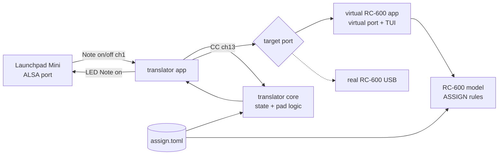

# feat: Launchpad Mini → RC-600 translator and virtual RC-600

## Overview

Two programs in a new Python repo `~/dev/launchpad-rc600`:
1. **Translator**: reads pads from Launchpad Mini (1st gen) and sends CC on channel 13 to an RC-600 MIDI port. Lights the pads to show the state.
2. **Virtual RC-600**: a terminal program with its own MIDI port. It applies the RC-600 ASSIGN rules to incoming messages and shows the result (6 PLAY LEVEL bars, 4 Track FX states, message log).

The translator does not know if the target is real or virtual. The target is only a port name (see origin: R6).

Both programs run on the target laptop **lubudu**. Development and automated tests run on the local development machine (see Target Host).

## Problem Frame

Launchpad sends notes on channel 1. RC-600 ASSIGN accepts only CC 1–31/64–95 on `RX CH CTL = 13`. Both devices are USB devices, so the laptop must translate. Before the real Boss is connected, the layout and the logic must be tested on a virtual RC-600 (see origin: Problem Frame).

## Requirements Trace

- R1. 8×8 layout: columns 1–6 = faders TRK1–6 (bottom row = 0, top row = 100); columns 7–8, top 2 rows (2×2 block) = Track FX A–D.
- R2. Fader pad → CC with level value on channel 13; LED bar in the column.
- R3. FX pad → flip the state, send an explicit on/off value; the LED shows the state.
- R4. At startup, send the start state (levels 71, FX off) and set the LEDs. Changed from 100 after the first Launchpad test: the user wants room to raise levels to unity.
- R5. CC numbers are not 1–4 (Pacer) and are inside 1–31 or 64–95.
- R6. The translator only knows a port name, not the target type.
- R7. The translator logs every input and output message.
- R8. The virtual RC-600 is a TUI with its own MIDI port.
- R9. The virtual RC-600 has an ASSIGN config (slot → CC → TARGET, MIN/MAX), 10 slots used.
- R10. The virtual RC-600 reacts only to channel 13 and to assigned CC. Other messages are logged with the reason.
- R11. Screen: 6 level bars, 4 FX states, message log.
- R12. The virtual RC-600 checks the limits: max 16 slots, slots 1–4 reserved for Pacer.
- Success criteria (origin): pads change the virtual state and the LEDs agree; configuration errors are visible; the ASSIGN config can be typed into the real RC-600 without guessing.

## Scope Boundaries

From the origin document, unchanged:
- No Bitwig integration.
- No live mode without the laptop; no RPi / MIDIMatrix deployment.
- No Input FX, reverse, play/stop, rhythm, Master FX.
- No continuous controllers (encoders, FX parameters).
- No reading of state from the real RC-600.
- No on-screen virtual Launchpad grid; input always from the physical Launchpad.

## Context & Research

### Relevant Code and Patterns

- The repo is new and empty. There is no local code to follow.
- Launchpad facts were checked in this session on the real device (`hw:7,0,0`, ALSA client 44):
  - pad note = `row × 16 + col`, row 0 is the top row, channel 1, velocity 127 on press, Note off on release;
  - right round buttons are notes 8, 24, …, 120; top round buttons are CC 104–111;
  - LED color = Note on velocity, `16 × green + red + 12` (green and red 0–3); `B0 00 00` turns off all LEDs.
- The LED animation script from this session (`launchpad_anim.sh` in the session scratchpad) shows the working LED message format.

### Sources from the music-box-wiki

- `wiki/troubleshooting/CTL channel — Pacer vs LCXL3.md`: `RX CH CTL = 13`, one channel for Program Change and CC.
- `wiki/concepts/ASSIGN — RC-600 mapping.md`: ASSIGN structure, 16 slots per memory, CC 1–31/64–95 only. **Some of this page is out of date (LCXL3 parts)**, so use only the RC-600 facts that the manual confirms.
- `raw/extracted/RC-600_Manual.txt`, ASSIGN section (about lines 1454–1720):
  - SOURCE `MIDI CC#01–31`, `MIDI CC#64–95`.
  - `SOURCE ACT. LO/HI` (0–127): the source range that controls the target.
  - `TRK1–6 LEVEL`: PLAY LEVEL 0–200.
  - `T FX A–D`: "Turn the track FX A–D on/off **for the currently selected FX bank**". Bank-specific targets also exist: `T FX AA–DD`.
  - `TARGET MIN/MAX`: the target range.
  - `SOURCE MODE` (MOMENT/TOGGLE) is described for momentary footswitches. The manual does not say how a CC value maps to on/off.

### Target Host: lubudu

Checked over SSH on 2026-11-01 (`ssh lubudu`, 192.168.1.24, user `wojtas`):
- ThinkPad, Void Linux, **i686 (32-bit)**, glibc 2.41, runit (no systemd), 2 cores, 1.9 GB RAM.
- System Python 3.13.1. `aconnect` and `aseqdump` are installed. `snd_seq` is loaded. User `wojtas` is in the `audio` group.
- Not installed: `uv`, `jj`, `git`, `gcc`, `pkg-config`, `alsa-lib-devel`, `curl`, `wget`, `rsync`.
- Void repo has `alsa-lib-devel` and the C++ `rtmidi` library, but no `python3-rtmidi` package.
- `python-rtmidi` 1.5.8 on PyPI has wheels only for CPython 3.8–3.12 on x86_64/aarch64 (Linux). There is **no i686 wheel and no cp313 wheel**. On lubudu it must be built from the sdist.
- `uv` 0.13.6 has an `i686-unknown-linux-gnu` release. It can use the system Python 3.13.

Run model: the user starts the programs over SSH (`ssh -t lubudu`); the TUI draws in that terminal. Autostart (a runit service) is out of scope.

## Key Technical Decisions

- **Python + uv, libraries `mido` with the `python-rtmidi` backend, `rich` for the TUI.** `mido` gives a simple message model and ALSA virtual ports through rtmidi. The TUI only displays; it takes no keyboard input, so `rich` live display is enough. Textual would add an app framework that we do not need.
- **Python 3.14 on both machines.** After a system update lubudu has system Python 3.14.8 (uv has no managed Python for i686). The project pins 3.14 (`requires-python`, `.python-version`), so local tests and lubudu run the same version. On lubudu `uv sync --no-dev --python /usr/bin/python3`; building `python-rtmidi` there also needs `python3-devel`.
- **One config file (`assign.toml`) is the single source of the mapping.** It describes the RC-600 ASSIGN slots (slot number, source CC, target, target min/max) and the reserved Pacer slots. The translator takes its CC numbers from it. The virtual RC-600 uses it as its ASSIGN table. The same file is the sheet for typing the config into the real RC-600 (success criterion 3). Two separate files would allow drift without any benefit.
- **The pure core is separate from I/O.** Pad math, translator state, and the RC-600 model are pure functions/classes with no ports. The apps only connect ports to the core. This gives fast unit tests without mocks.
- **FX target: `T FX A–D` (current bank).** This is what the requirements mean ("Track FX A–D"). Fact from the manual: the target acts on the currently selected bank. The virtual RC-600 models one bank only and shows this in the UI as a note.
- **What the simulator validates, and what it does not.** It validates port wiring, channel 13, CC numbers, the pad layout, LED agreement, and the config limits. It does not validate the value semantics of the real RC-600: the FX on/off threshold, the level rounding, and per-memory behavior. The model and the translator use the same assumptions, so the "model = translator" tests are a regression guard, not evidence about the real device. These semantics are checked first on the real RC-600.
- **FX slots use `SOURCE MODE = MOMENT`, `ACT LO/HI = 0/127`, `TARGET MIN/MAX = OFF/ON`.** Manual (ASSIGN, SOURCE MODE): with MOMENT the target is at its minimum (off) and at its maximum (on) only while the source is "pressed"; with TOGGLE each press flips the state. MOMENT therefore makes the FX state follow the CC value, which is what R3 needs. TOGGLE is not used.
- **FX values are only 0 (off) and 127 (on).** The manual does not give the threshold for on/off. The two extreme values work with any threshold. The virtual RC-600 uses the rule "value ≥ 64 → on" and shows it as an assumption.
- **Level mapping: linear from ACT LO/HI (0–127) to TARGET MIN/MAX (0–100).** The 8 rows are levels 0, 14, 29, 43, 57, 71, 86, 100. The translator sends the CC value that maps to each level by this rule. The real rounding of RC-600 is not known (see deferred questions). The model uses one named function with "round half up". The translator uses a CC value that gives the same level with floor and with round where such a value exists: 0, 18, 37, 55, 73, 127 for levels 0, 14, 29, 43, 57, 100. For levels 71 and 86 no such value exists (floor needs CC 91 / 110, round needs CC 90 / 109); the translator uses the round values 90 and 109, and these two rows are on the real-device check list.
- **CC numbers: 64–69 → `TRK1–6 LEVEL`, 70–73 → `T FX A–D`; slots 5–14.** These are outside the Pacer CC 1–4 and inside the ASSIGN range. They are a contiguous block, easy to type in. Slots 1–4 stay reserved for Pacer, slots 15–16 are free.
- **Unused pads and round buttons: LEDs off, presses ignored, with a log line.** This answers the deferred origin question about the other pads. The simplest choice; it reserves nothing.
- **Fail fast at startup.** If the Launchpad port or the target port is not found, or `assign.toml` breaks a rule (R5, R12), the program stops with a clear message. No fallbacks (user rules).
- **On exit, the translator turns off all LEDs (`B0 00 00`).** The same behavior as the animation script.

## Open Questions

### Resolved During Planning

- Exact CC numbers (origin, deferred): 64–69 and 70–73, see above.
- Behavior of the other pads (origin, deferred): LEDs off, presses ignored and logged.
- Correct TARGET name for Track FX: `T FX A–D` (manual).

### Deferred to Implementation

- **Resolved on the RC-600 (2026-11-01): FX slots use ACT LO/HI 64/127 with MOMENT; 127 → on, 127 again → on, 0 → off. Level rows 71 and 86 are correct (round). USB MIDI from Linux works.** Original note: **Confirm `T FX A–D` with SOURCE MODE = MOMENT** (origin R3) — the first short check on the real RC-600: CC 127 → FX on; CC 127 again → FX still on; CC 0 → FX off. Also confirm that `TARGET MIN/MAX` for `T FX` shows OFF/ON (the manual says only "depends on the parameter"). The FX `SW MODE` (FX A–D menu) is described for onboard switches and footswitches, not for ASSIGN; the check confirms that it has no effect.
- **RC-600 rounding of CC → PLAY LEVEL** (origin R2): check on the real device by reading PLAY LEVEL on its screen for each of the 8 rows, especially the rows for levels 71 and 86. If it differs, change only the level-to-CC function.
- **Does RC-600 accept MIDI over USB from Linux (ALSA port)?** (origin R6): only needed for the real device; it does not block this plan.

## High-Level Technical Design

> *This illustrates the intended approach and is directional guidance for review, not implementation specification. The implementing agent should treat it as context, not code to reproduce.*



Pad press flow (directional):

```
on Note on (row, col):
  if col in 0..5        -> level = LEVELS[7 - row]; state.levels[col] = level
                           out: CC(64 + col, cc_for(level)) on ch13
                           leds: level 0 (row 7) -> whole column off;
                                 other levels -> rows from `row` down to row 7 on, rows above off
  elif col in 6..7 and row in 0..1 -> fx index = row * 2 + (col - 6)   # A B / C D; flip state
                           out: CC(70 + idx, 127 if on else 0) on ch13
                           leds: pad bright / dim
  else                  -> log "ignored pad"
```

## Implementation Units

- [x] **Unit 1: Project skeleton and config model**

**Goal:** A working uv project with the `assign.toml` config and its validation.

**Requirements:** R5, R9, R12

**Dependencies:** None

**Files:**
- Create: `pyproject.toml`, `README.md`, `assign.toml`
- Create: `src/launchpad_rc600/__init__.py`, `src/launchpad_rc600/assign.py`
- Test: `tests/unit/test_assign.py`

**Approach:**
- Create the project with `uv init --package` (build backend and src layout, so the script entries install), pin Python 3.13, add `mido`, `python-rtmidi`, `rich`, and `pytest` as a dev dependency. Start version control with jj (git if jj is not available).
- `assign.py` loads the TOML into a typed structure: the reserved slots (1–4, Pacer, CC 1–4) and the slot list (slot, source CC, source mode, ACT LO/HI, target, min, max). The control channel 13 is a constant in the code, not a config field.
- The model uses ACT LO/HI and TARGET MIN/MAX from the config for its mapping. The README sheet takes every field from the config.
- Validation returns all violations, not only the first: slot outside 1–16, duplicate slot, slot in the reserved range, CC outside 1–31/64–95, CC used by a reserved slot, duplicate CC, unknown target, min > max. No separate total-count rule: unique slots inside 1–16 already limit the total to 16 (R12).
- Every code file starts with two `ABOUTME:` lines (user rules).

**Execution note:** Test-first.

**Test scenarios:**
- Happy path: the shipped `assign.toml` loads and has no violations; it has 10 slots (6 × `TRKn LEVEL`, 4 × `T FX A–D`) with CC 64–73.
- Error path: a slot with CC 40 → violation "CC outside 1–31/64–95".
- Error path: a slot with CC 2 → violation "CC used by Pacer".
- Error path: a slot with number 3 → violation "slot reserved for Pacer".
- Error path: a slot with number 17 → violation "slot outside 1–16".
- Error path: two slots with the same CC → violation that names both slots.
- Edge case: CC 31 and CC 64 are valid; CC 32 and CC 96 are not.
- Error path: ACT LO > ACT HI, or ACT values outside 0–127 → violation; unknown source mode → violation.
- Edge case: a config with several errors returns all of them.

**Verification:**
- The validator rejects each broken config with a message that names the slot and the rule.

- [x] **Unit 2: Launchpad pad and LED model**

**Goal:** Pure functions for Launchpad Mini 1st gen addressing and LED messages.

**Requirements:** R1, R2, R3

**Dependencies:** Unit 1

**Files:**
- Create: `src/launchpad_rc600/launchpad.py`
- Test: `tests/unit/test_launchpad.py`

**Approach:**
- Note ↔ (row, col) for the 8×8 grid; recognize the right round buttons (col 8) and the top CC buttons separately.
- Color constructor from (red 0–3, green 0–3) to velocity; named colors for the layout (fader lit, FX on, FX off).
- Builders for one pad LED message, a full-grid frame, and the reset message.

**Execution note:** Test-first.

**Test scenarios:**
- Happy path: note 0 → (0, 0); note 119 → (7, 7); note 112 → (7, 0) (bottom-left pad, seen in the session log).
- Happy path: (row 3, col 5) → note 53 and back.
- Edge case: note 8 and note 120 → right round button, not a grid pad.
- Edge case: CC 104 → top button; CC 103 → not a Launchpad button.
- Happy path: color (red 3, green 0) → velocity 0x0F; (0, 3) → 0x3C; (3, 3) → 0x3F (values used in this session).
- Error path: color component 4 → error.
- Happy path: the reset message is CC 0 value 0 on channel 1.

**Verification:**
- The functions reproduce the values that worked on the real Launchpad in this session.

- [x] **Unit 3: Translator core**

**Goal:** The translator state and the pad logic, without ports.

**Requirements:** R1, R2, R3, R4, R5

**Dependencies:** Units 1, 2

**Files:**
- Create: `src/launchpad_rc600/translator.py`
- Test: `tests/unit/test_translator.py`

**Approach:**
- State: 6 levels and 4 FX flags. Start state: levels 71, FX off.
- One entry point for a Launchpad message. It returns the RC-600 messages to send, the LED messages, and log lines. No I/O inside.
- One function for the startup sequence: all CC for the start state, plus the full LED frame.
- The CC numbers come from the loaded `assign.toml` (by target name), not from constants.
- The level → CC value function is separate and named, so the deferred rounding check changes only this function.
- Note off and presses on the ignored areas produce only log lines.

**Execution note:** Test-first.

**Test scenarios:**
- Happy path: startup → 6 CC (64–69, value for 100) + 4 CC (70–73, value 0), all on channel 13; LED frame with full bars in columns 1–6 and dim FX pads.
- Happy path: press (row 7, col 0) → CC 64 with the value for level 0; LEDs of column 1 all off.
- Happy path: press (row 0, col 5) → CC 69 with the value for level 100; full bar in column 6.
- Happy path: press (row 4, col 2) → level 43 on TRK3; LEDs on in rows 4–7 of column 3, off in rows 0–3.
- Happy path: press FX A twice → CC 70 value 127, then CC 70 value 0; LED bright, then dim.
- Edge case: level → CC value for each of the 8 levels maps back to the same level with the linear rule from the config (0–127 → 0–100).
- Edge case: Note off → no RC-600 message, no LED change.
- Happy path: FX pads map as (row 0, col 6) = A, (0, 7) = B, (1, 6) = C, (1, 7) = D.
- Edge case: pad (row 2, col 6) and pad (row 6, col 7) (unused area) → no RC-600 message, one "ignored" log line.
- Edge case: top button CC 104 → ignored with a log line.
- Error path: a message on a channel other than 1 from the Launchpad → ignored with a log line.

**Verification:**
- For each pad of the layout, the core returns the right CC and LED messages; all CC are on channel 13 and use only the config CC numbers.

- [x] **Unit 4: RC-600 model**

**Goal:** A pure model of the RC-600 ASSIGN behavior for the 10 used targets.

**Requirements:** R9, R10, R12

**Dependencies:** Unit 1

**Files:**
- Create: `src/launchpad_rc600/rc600.py`
- Test: `tests/unit/test_rc600.py`

**Approach:**
- Built from a validated `assign.toml`. State: 6 PLAY LEVEL values, 4 Track FX flags (one bank). Start state: **unknown** for every level and FX (shown as "?"). The real device state is also unknown to the translator, and an unknown start state makes the e2e test prove that the startup messages arrived.
- One entry point per MIDI message. It returns the change ("TRK2 LEVEL ? → 43") or the reason for ignoring it: wrong channel, not a CC, CC outside 1–31/64–95, Pacer slot (not modeled), CC without a slot.
- Program Change on channel 13 is logged as "memory change, state not modeled". ASSIGN and track state are stored per memory on the real RC-600, so after a memory change the Launchpad LEDs can show a stale state. The README documents this; the translator has no extra logic for it.
- Level: linear mapping from ACT range 0–127 to target min/max. FX: value ≥ 64 → on (assumption, named in the code and in the UI).
- The rules come from the manual sections listed in Context & Research. Each rule cites its source in a comment.

**Execution note:** Test-first.

**Test scenarios:**
- Happy path: CC 65 value 127 on channel 13 → TRK2 LEVEL 100.
- Happy path: CC 64 value 0 on channel 13 → TRK1 LEVEL 0.
- Happy path: CC 72 value 127, then value 0 → T FX C on, then off.
- Error path: CC 65 on channel 1 → ignored, reason "channel 1, expected 13".
- Error path: CC 40 on channel 13 → ignored, reason "CC 40 cannot be an ASSIGN source".
- Error path: CC 20 on channel 13 → ignored, reason "no ASSIGN slot for CC 20".
- Error path: CC 2 on channel 13 → ignored with reason "Pacer slot (not modeled)", so Pacer traffic is visible but not confused with errors.
- Error path: Note on on channel 13 → ignored, reason "not a CC".
- Edge case: Program Change on channel 13 → logged "memory change, state not modeled"; state does not change.
- Edge case: before any message, all levels and FX are unknown.
- Edge case: FX value 63 → off, 64 → on.
- Integration (pure): the startup message list from the translator core, applied to the model → model state equals the translator state.
- Integration (pure): each pad press from the translator core, applied to the model → model state equals the translator state (property over all 64 pads).

**Verification:**
- The model and the translator agree for all pads; every ignored message has a reason.

- [x] **Unit 5: Virtual RC-600 app (TUI)**

**Goal:** The `rc600-sim` program: an ALSA virtual input port named "RC-600 SIM" and a terminal screen.

**Requirements:** R8, R10, R11, R12

**Dependencies:** Unit 4

**Files:**
- Create: `src/launchpad_rc600/sim_app.py`
- Modify: `pyproject.toml` (script entry `rc600-sim`)
- Test: `tests/integration/test_sim_app.py`

**Approach:**
- Startup: load and validate the config (`--config`, default `assign.toml`); on a violation, print all violations and stop. After the port is open, print a "ready" line.
- Every log line is flushed at once (output is read through a pipe in tests).
- Open the virtual port, feed each message into the model, and refresh the screen: 6 level bars (0–200 scale with a 100 mark), 4 FX states (with the "current bank" note), and the last log lines (R11). One short mapping line at the top, built from the config, for example `ch13 · CC64–69 → TRK1–6 LEVEL · CC70–73 → T FX A–D`. The full ASSIGN sheet is in the README, not on the screen.
- A `--plain` option prints one log line per event and no screen. The automated end-to-end test uses this mode, and it is useful for debugging.

**Test scenarios:**
- Integration: start the app in `--plain` mode, send CC 66 value 127 on channel 13 to its port from the test through a real ALSA port → the output has a line with "TRK3 LEVEL" and the new value.
- Integration: send CC 66 on channel 1 → the output has an "ignored" line with the channel reason.
- Error path: start with `--config` pointing to a file that has a slot in 1–4 → the program stops with a non-zero exit code and names the slot.
- Integration: the port named "RC-600 SIM" is visible in the system MIDI port list while the app runs.

**Verification:**
- The app shows level and FX changes for valid messages and reasons for invalid ones; a broken config stops it at startup.

- [x] **Unit 6: Translator app**

**Goal:** The `lp-rc600` program that connects the Launchpad to a target port.

**Requirements:** R4, R6, R7

**Dependencies:** Unit 3

**Files:**
- Create: `src/launchpad_rc600/translator_app.py`
- Modify: `pyproject.toml` (script entry `lp-rc600`)
- Test: `tests/integration/test_translator_app.py`

**Approach:**
- Options: `--launchpad` (port name part, default "Launchpad Mini") and `--out` (target port name part, for example "RC-600 SIM" or the real RC-600 name). No target-type logic.
- Startup: validate the config, find both ports (stop with a list of available ports if a port is missing; stop with the list of matching ports if a name part matches more than one port), send the startup sequence, and set the LEDs.
- Options also include `--config` (default `assign.toml`). After the startup sequence, print a "ready" line.
- Loop: pass each Launchpad message to the core and send its results. Log every input and output message with time. Every log line is flushed at once.
- On exit (Ctrl+C, SIGHUP when the SSH session drops, SIGTERM): send the LED reset.
- A port that disappears while the program runs is out of scope. The README says: start `rc600-sim` before `lp-rc600`, and restart `lp-rc600` after a simulator restart or a Launchpad reconnect. Tests send SIGINT directly to the Python process, not through `uv run`.

**Test scenarios:**
- Error path: `--out` with a name that does not exist → stop with a non-zero exit code and a list of available ports.
- Error path: `--launchpad` with a name that does not exist → the same.
- Integration: a test-owned virtual port acts as the Launchpad input, another test-owned port receives the output. Start → the receiver gets the 10 startup CC on channel 13. Send Note on 112 → the receiver gets CC 64 with the level-0 value. The log has the input and the output lines.
- Integration: the test-owned Launchpad port receives the LED frame at startup and the LED reset at exit, for SIGINT and for SIGTERM.

**Verification:**
- With real ALSA ports, the translator sends the startup state, translates presses, and logs both directions.

- [x] **Unit 7: End-to-end test and manual check sheet**

**Goal:** Prove the full chain, and give a sheet for the manual test with the physical Launchpad and for the real RC-600 setup.

**Requirements:** success criteria 1–3

**Dependencies:** Units 5, 6

**Files:**
- Create: `tests/e2e/test_chain.py`
- Modify: `README.md` (run instructions, manual check list, ASSIGN sheet)

**Approach:**
- The automated test starts `rc600-sim --plain` and `lp-rc600` as real processes. A test-owned virtual port with the same messages as the Launchpad is the input. The test waits for the "ready" line of each program before it continues (the simulator first, then the translator). Assertions use the simulator output and the translator stdout.
- The README gets:
  - the manual check with the physical Launchpad: every fader row, each FX twice, an unused pad, Ctrl+C turns off the LEDs;
  - the ASSIGN sheet from `assign.toml` in the RC-600 menu order (slot, SW = ON, SOURCE, SOURCE MODE, ACT LO/HI, TARGET, TARGET MIN/MAX). Fields that are not verified on the device are marked "to verify on device". The sheet says that ASSIGN is stored per memory: write it (WRITE) to each memory where the Launchpad is used (manual, "ASSIGN" NOTE);
  - the run order: `rc600-sim` first, then `lp-rc600`; restart `lp-rc600` after a simulator restart or a Launchpad reconnect;
  - the list of deferred checks for the real RC-600, in this order: `T FX` with SOURCE MODE = MOMENT (first), rounding with the rows for levels 71 and 86, USB MIDI, `USB IN THRU = OFF`;
  - the memory note: ASSIGN and track state are per memory; after a memory change (for example a Program Change from Pacer) the LEDs can show a stale state.

**Test scenarios:**
- Integration (e2e): press the pads for levels 0, 43, 100 on TRK1, TRK3, TRK6 → the simulator shows those exact levels.
- Integration (e2e): press FX B twice → the simulator shows on, then off.
- Integration (e2e): the simulator starts with all states unknown; after the translator startup, before any press → the simulator log has the 10 startup CC, and it shows levels 100 and FX off.
- Integration (e2e): press an unused pad → the simulator shows no change and the translator logs "ignored".

**Verification:**
- The automated chain test passes with clean output, and the manual check with the physical Launchpad passes.

- [ ] **Unit 0: Spike — build `python-rtmidi` on lubudu**

**Goal:** Prove that `python-rtmidi` builds and opens an ALSA virtual port on lubudu (i686, Python 3.13) before the main work. This is the biggest platform risk.

**Requirements:** R6, R8 (on the target host)

**Dependencies:** None. It runs in parallel with the local work (Units 1–7) and blocks only Unit 8. Blocked until the system update on lubudu ends (`xbps-install` is locked).

**Approach:**
- Install on lubudu: `gcc`, `pkg-config`, `alsa-lib-devel`, `rsync` (`sudo xbps-install`, with user approval).
- Copy the `uv` i686 binary to `~/.local/bin` with `scp` (lubudu has no `curl`/`wget`).
- In a scratch directory on lubudu: `uv venv --python /usr/bin/python3`, install `python-rtmidi` and `mido`, open a virtual port, and check it in `aconnect -l`.
- Plug the Launchpad into lubudu: check it in `aconnect -l`, see a pad press in `aseqdump`, and send one LED frame from Python.
- If the build fails, stop and ask the user (fail fast). Do not switch libraries without approval.

**Verification:**
- A virtual port opened from Python on lubudu is visible in `aconnect -l`.
- The Launchpad on lubudu sends pad presses and shows an LED frame sent from Python.

- [ ] **Unit 8: Deploy and run on lubudu**

**Goal:** A repeatable way to put the code on lubudu and run both programs there.

**Requirements:** success criteria 1–3 on the target host

**Dependencies:** Units 0, 7

**Files:**
- Modify: `README.md` (section "Run on lubudu")

**Approach:**
- Copy the repo with `rsync` (no VCS on lubudu; exclude `.venv`, `.jj`, `.git`).
- On lubudu: `uv sync --no-dev` (builds `python-rtmidi`).
- Run in two SSH sessions: `ssh -t lubudu` → `uv run rc600-sim`, and `uv run lp-rc600 --out "RC-600 SIM"`.
- Automated tests stay on the local machine. On lubudu, only the smoke check and the manual check with the physical Launchpad.

**Test scenarios:**
- Smoke (lubudu): `rc600-sim --plain` starts and the port "RC-600 SIM" is visible in `aconnect -l`.
- Manual (lubudu): the check list from Unit 7 with the physical Launchpad plugged into lubudu.

**Verification:**
- The manual check list from Unit 7 passes on lubudu.

## System-Wide Impact

- **MIDI THRU on the real RC-600:** RC-600 MIDI THRU is a setting per input (MIDI IN / USB IN → OFF, MIDI OUT, USB OUT, USB & MIDI). If USB IN is forwarded, CC 64–73 on channel 13 reach M:S and MicroFreak (CC 64–69 are standard Sustain/Portamento/… controllers). Set `USB IN THRU = OFF` before the real-device test, or verify that no downstream device listens on channel 13. This does not affect the simulator.
- **RC-600 memories:** ASSIGN and track state are stored per memory. A memory change makes the LEDs stale. The simulator logs Program Change as "memory change, state not modeled"; the README documents it.
- **Pacer:** shares channel 13 and slots 1–4. The config keeps them reserved, and the model shows Pacer traffic as "not modeled", not as an error.
- **Startup changes the sound** (origin key decision): starting the translator against the real RC-600 sets all levels to 100 and FX off. The README says this clearly.

## Risks & Dependencies

- **Manual assumptions (FX threshold, rounding):** limited to two named functions and listed for the real-device check. SOURCE MODE = MOMENT makes the FX state follow the CC value; extreme FX values (0/127) remove the threshold risk.
- **`T FX A–D` acts on the current bank:** if another bank is selected on the RC-600, the pads switch other effects. The UI note and the README describe this. Bank-specific targets (`T FX AA–DD`) are an option for later, outside this scope.
- **ALSA port names can change** (for example, card numbers): ports are found by a name part, not by a number. Zero or more than one match stops the program (fail fast).
- **Tests need the ALSA sequencer** (real virtual ports, no mocks). They work on the local development machine. They will not work in a CI without ALSA. There is no CI in scope.
- **`python-rtmidi` on lubudu (i686, Python 3.13):** no wheel, so it must build from source. It needs a C++ compiler and ALSA headers. Unit 0 checks this first. If the build fails, the library choice must be decided again with the user.
- **lubudu has no network download tools** (`curl`, `wget`): `uv` and the code go there over `scp`/`rsync`. `uv sync` itself downloads from PyPI, so lubudu needs internet access.

## Documentation / Operational Notes

- The music-box-wiki has out-of-date LCXL3 information (list of files from the brainstorm). Fixing the wiki is a separate task, outside this plan. After implementation, add a short wiki page that links to this repo and the ASSIGN sheet.

## Sources & References

- **Origin document:** [docs/brainstorms/2026-11-01-launchpad-rc600-requirements.md](../brainstorms/2026-11-01-launchpad-rc600-requirements.md)
- RC-600 manual text: `~/dev/music-box-wiki/raw/extracted/RC-600_Manual.txt` (ASSIGN, about lines 1454–1720)
- Wiki: `wiki/troubleshooting/CTL channel — Pacer vs LCXL3.md`, `wiki/concepts/ASSIGN — RC-600 mapping.md`
- Launchpad behavior: checked in this session on the real device (`aseqdump` capture, LED tests)
