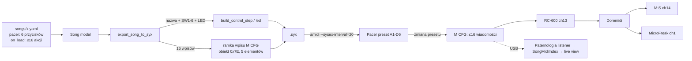

# feat: Wiadomości MIDI przy załadowaniu presetu Pacera (M CFG) w Paternologii

## Overview

Pacer ma funkcję **M CFG (Preset Recall MIDI Configuration)**. Gdy Pacer ładuje preset, wysyła do 16 wiadomości MIDI. Plan ma dwie fazy:

- **Faza A — weryfikacja na sprzęcie.**
  - Unit 1: bezpieczna weryfikacja. Sprawdzamy, że M CFG działa i że rozumiemy format SysEx. Nie ryzykujemy przy tym danych w Pacerze.
  - Unit 2: test przydatności. Sprawdzamy, czy M CFG może ustawić startowy stan wszystkich urządzeń rigu (RC-600, Model:Samples, MicroFreak) przy zmianie utworu.
- **Faza B — implementacja w Paternologii** (Unit 3–6). Dodajemy pole „wiadomości przy załadowaniu” do utworu (YAML + UI) oraz eksport do `.syx`.

Faza B startuje tylko po werdykcie **GO** albo **GO z ograniczeniami** z Unit 2 (kryteria w Unit 2). Werdykt **NO-GO** kończy plan na dokumentacji wyniku.

**Terminy:** „preset” = preset Pacera A1–D6. „Wpis M CFG” = jedna z 16 pozycji M CFG w presecie.

## Problem Frame

Teraz każdy utwór w Paternologii zapisuje tylko przyciski SW1–SW6 w presecie Pacera. Startowy stan urządzeń (pattern M:S, preset MicroFreaka, stan RC-600) ustawia muzyk ręcznie albo pierwszym naciśnięciem przycisku. M CFG może zrobić to automatycznie w chwili zmiany presetu, bez komputera. To pasuje do celu „setup live — dual mode z/bez kompa” (`music-box-wiki/wiki/workflows/Setup live — dual mode z bez kompa.md`).

## Requirements Trace

- R1. Weryfikacja na sprzęcie nie może uszkodzić ani nadpisać istniejących presetów bez backupu. Żadna wysyłka (test ani restore) nie może zawierać ramki `TARGET_GLOBAL`.
- R2. Potwierdzić format SysEx M CFG (obiekt, elementy, typy wiadomości) przez porównanie z prawdziwym zrzutem z Pacera.
- R3. Ustalić, w jakich warunkach Pacer wysyła M CFG (sposób zmiany presetu, wgranie SysEx do presetu, włączenie zasilania) i do jakich wyjść (USB, DIN).
- R4. Sprawdzić end-to-end, czy każde urządzenie rigu osiąga zdefiniowany stan docelowy po wiadomościach M CFG przez łańcuch `Pacer → RC-600 → Doremidi → M:S / MicroFreak`.
- R5. Utwór w Paternologii może zdefiniować do 16 wiadomości „przy załadowaniu”, z tym samym słownikiem akcji co przyciski (urządzenie + typ + wartość).
- R6. Eksport `.syx` zapisuje wszystkie 16 wpisów M CFG (aktywne + wyczyszczone), tak samo jak kroki przycisków.
- R7. Testy jednostkowe, integracyjne (API) i e2e pokrywają nową funkcję (wymóg z CLAUDE.md).

## Scope Boundaries

- Poza zakresem: zmiana ustawień Global Pacera (np. `M OUT`). Jeśli test pokaże, że trzeba je zmienić, użytkownik robi to ręcznie z panelu.
- Poza zakresem: typy M CFG, których rig nie używa (NRPN, MMC, Relay). Relaye i EXP nie są podłączone (wiki: Pacer.md).
- Poza zakresem: zapis M CFG do CURRENT (index `0x00`). `PacerExportSettings` dopuszcza tylko A1–D6, więc Faza B tego nie potrzebuje.
- Poza zakresem: wysyłanie stanu startowego bezpośrednio z Paternologii (bez Pacera). To osobny pomysł.
- Poza zakresem: LCXL3.

## Context & Research

### Relevant Code and Patterns

- `packages/paternologia/src/paternologia/pacer/sysex.py` — `PacerSysExBuilder.build_control_step`. Ramka M CFG ma podobny układ (elementy `(n-1)*6 + 1..5`: channel, msg_type, data1, data2, data3), ale **bez elementu 6 (active)** w dumpie — patrz niżej. Bajt obiektu: `0x7E` zamiast `0x0D–0x12`.
- `packages/paternologia/src/paternologia/pacer/export.py` — `export_song_to_syx`. Wzorzec „zawsze zapisuj wszystkie kroki, nieużywane czyść” trzeba powtórzyć dla 16 wpisów M CFG.
- `packages/paternologia/src/paternologia/pacer/mappings.py` — `action_to_midi` mapuje akcję na typy wiadomości **stompswitcha**. Fakty ważne dla planu:
  - `PATTERN` → `MSG_SW_PRG_STEP (0x46)`, którego M CFG nie ma. W M CFG pattern trzeba wysłać jako `PRG_BANK (0x45)`.
  - `action_to_midi` **nie** stosuje `preset_display_offset`. Offset działa tylko w UI (`display.py`: `to_display`/`to_stored`, `routers/songs.py`). YAML przechowuje wartość surową.
  - `action_to_midi` nie używa pól `Action.bank_lsb`/`bank_msb`.
- `packages/paternologia/src/paternologia/pacer/constants.py` — tu dodać `CONTROL_MIDI = 0x7E` i `MSG_LOAD_CC = 0x65`.
- `packages/paternologia/src/paternologia/models.py` — `Song`, `PacerButton`, `Action`, `PacerConfig` (`record_trigger_channel`, `record_start_note`, `record_stop_note`).
- `packages/paternologia/src/paternologia/midi/index.py` — `SongMidiIndex.build` mapuje (kanał, program) → utwór **tylko** z akcji `PRESET` w `song.pacer[*].actions`. `midi/listener.py` publikuje zdarzenie po Program Change.
- `packages/paternologia/src/paternologia/routers/songs.py` — `_build_song_from_form` buduje cały `Song` od nowa z pól `button_{i}_action_{j}_*`. Błąd walidacji → `HTTPException(400)` z `_format_validation_error`. Partiale `/partials/action-row`, `/partials/action-types`, `/partials/action-fields` i szablony `action_row.html`, `action_fields.html` mają na stałe `button_idx`/`action_idx`. JS w `song_edit.html` renumeruje indeksy.
- Testy: `tests/test_pacer_sysex.py`, `tests/test_pacer_export.py`, `tests/test_pacer_mappings.py`, `tests/test_models.py`, `tests/test_midi_index.py`, `tests/test_api.py`, `tests/test_pacer_api.py`, `tests/test_e2e.py`.

### Referencja protokołu (pacer-editor, lokalna kopia)

`~/dev/paternologia/workspace/pacer_programming/pacer-editor/`:
- `src/pacer/constants.js`: `CONTROL_MIDI = 0x7E` („MIDI configuration”). Typy M CFG: `MSG_LOAD_CC 0x65` (`controller, value, NOT_USED`), `MSG_SW_NOTE 0x43`, `MSG_SW_PRG_BANK 0x45`, `MSG_SW_NRPN_COARSE 0x57`, `MSG_SW_NRPN_FINE 0x58`, `MSG_SW_MMC 0x55`, `MSG_SW_RELAY 0x59`, `MSG_CTRL_OFF 0x61`.
- `src/pacer/sysex.js`: `buildMidiSettingsSysex` wysyła 6 elementów na wpis (z `active`). Parser `getMidiSetting` czyta tylko 5 elementów (20 bajtów).
- `dumps/A1.factory.txt` (linie 175+): prawdziwe ramki z Pacera mają **5 elementów na wpis, bez active**, np. `F0 00 01 77 7F 01 01 01 7E 01 01 00 00 02 01 61 00 03 01 00 00 04 01 00 00 05 01 00 0A F7`. Pusty wpis = typ `0x61`. Wpis 16 kończy się na elemencie `0x5F`.
- `requestPreset`: `F0 00 01 77 7F 02 01 <idx> 7F <cs> F7`, `cs = (128 - sum(02, 01, idx, 7F) % 128) % 128`.

Pacer-editor to reverse-engineering społeczności, nie dokumentacja Nektar. Dlatego R2 wymaga porównania z dumpem z egzemplarza użytkownika.

### Institutional Learnings

- AGENTS.md i README Paternologii: **zawsze** `--sysex-interval=20`. **Nigdy** `TARGET_GLOBAL (0x05)` + `elm=0x1E` (bricks Pacer).
- `SPEC_DEVICE_BACKUP.md` / `SPEC_PACER_BRIDGE.md`: full dump przez request `F0 00 01 77 7F 02 7F F7`. Pełny dump zawiera też **ustawienia globalne**, więc opisany tam pełny restore wysyła ramki `TARGET_GLOBAL`. Numer portu `hw:X,Y,Z` zmienia się po podłączeniu USB.
- Wiki `Pacer.md`: Pacer jest pierwszym ogniwem łańcucha, RC-600 `RX CH CTL = 13`, M:S kanał 14, MicroFreak kanał 1.

## Key Technical Decisions

- **Test na wolnym presecie testowym, nie na CURRENT ani na presetach utworów.** Preset testowy musi spełniać dwa warunki: (1) żaden `songs/*.yaml` go nie używa (`pacer_export.target_preset`; uwaga: `D6` zajmują `test-presety.yaml` i `test-presety-2.yaml`), (2) w backupie preset jest pusty albo jego zawartość jest zapisana. Wynik obu sprawdzeń zapisać w protokole przed konfiguracją.
- **Najpierw ręczne M CFG z panelu, potem dump.** Ustawiamy wpisy M CFG ręcznie w menu Pacera (Save → M CFG) i robimy zrzut. W Fazie A nie wysyłamy do Pacera żadnego SysEx zapisu poza selektywnym restore. Pierwszy zapis M CFG z naszego kodu następuje w Fazie B, po Unit 3.
- **Restore tylko selektywny.** Nigdy nie wysyłamy pełnego backupu w ramach tego planu. Restore = wycięte z backupu ramki `CMD_SET + TARGET_PRESET + <idx presetu testowego>`. Przed wysyłką automatyczne sprawdzenie: żadna ramka nie ma `0x05` na pozycji target.
- **Ramka wpisu M CFG = 5 elementów, jak w dumpie.** Nie wysyłamy elementu 6 (active), bo firmware go nie zwraca i nie wiadomo, czy go przyjmuje. Pusty wpis = typ `0x61` i zera. To jest ramka, którą Pacer sam generuje, więc ma najmniejsze ryzyko.
- **Osobna funkcja mapowania dla M CFG zamiast rozszerzania `action_to_midi`.** Kody typów są inne (CC `0x65` vs `0x40/0x47/0x48`, pattern `0x45` vs `0x46`). M CFG nie ma semantyki „down/up” ani toggle. Wspólne helpery (kanał urządzenia, `note_to_midi`, konwersja pattern → program) używamy ponownie (DRY).
- **Builder: współdzielona prywatna metoda budowy ramki „lista elementów”.** `build_control_step` (6 elementów) i metoda M CFG (5 elementów) różnią się obiektem i liczbą elementów. Wyciągamy wspólną budowę nagłówka, elementów i checksumy. `build_control_step` zachowuje dokładnie te same bajty co teraz.
- **Pole utworu: `on_load: list[Action]` (max 16), na poziomie `Song`, obok `pacer`.** Nazwa opisuje zachowanie, nie skrót z menu Pacera. Brak pola w YAML = pusta lista, więc istniejące utwory działają bez migracji.
- **Eksport zawsze zapisuje 16 wpisów.** Pusta lista czyści M CFG. Preset docelowy po eksporcie ma stan w pełni określony przez YAML.
- **Live view: `on_load` jest częścią identyfikacji utworu.** `SongMidiIndex.build` uwzględnia akcje `PRESET` z `on_load` (ta sama reguła co dla przycisków), żeby PC z M CFG jednoznacznie przełączał live view.
- **Bank dla `PRESET`: pola `Action.bank_lsb` / `bank_msb`** (domyślnie 0) jako data2/data3. To jawne pola modelu, nie wyliczenie. Unit 1 sprawdza, czy Pacer przy banku 0 wysyła Bank Select (CC0/CC32). Jeśli tak i urządzenie źle reaguje, decyzja wraca do przeglądu.

## Open Questions

### Resolved During Planning

- Czy Pacer ma tę funkcję? Tak — manual s. 14–15, wiki `Pacer.md`.
- Jak zakodować M CFG w SysEx? Obiekt `0x7E`, 16 wpisów × 5 elementów (dump `A1.factory.txt`). Potwierdzenie na egzemplarzu użytkownika w Unit 1.
- Semantyka `MSG_LOAD_CC (0x65)`: `data1 = CC`, `data2 = value`, `data3 = 0` (nieużywane; `constants.js`, dump `A5.modified.txt`). Unit 1 tylko to potwierdza.
- Format requestu dumpu jednego presetu: `F0 00 01 77 7F 02 01 <idx> 7F <cs> F7`.
- Wartość PC/pattern w mapowaniu: surowa wartość z YAML, bez `preset_display_offset` (jak w `action_to_midi`).
- Czy model przycisków można użyć ponownie? Tak — `Action` ma urządzenie, typ, wartość, CC, nutę, bank.

### Deferred to Implementation (odpowiedź z testu na sprzęcie)

- Czy M CFG uruchamia się po: (a) C/D, (b) `[Preset]`+bank+numer, (c) footswitch `PRSET`, (d) włączeniu zasilania, (f) zapisie SysEx do presetu (Faza B, po Unit 3)?
- Do jakich wyjść Pacer wysyła M CFG (USB, DIN, oba) przy obecnym `M OUT`?
- Czy `PRG_BANK` z bankiem 0 wysyła Bank Select (CC0/CC32) przed PC.
- Kolejność i odstępy między wiadomościami. Czy RC-600 / M:S gubią wiadomości wysłane szybko po sobie?
- Czy bridge Pacer → Bitwig przekazuje te wiadomości i czy to przeszkadza projektowi w Bitwig.
- Jaką metodą muzyk zmienia preset na żywo — od tego zależy kryterium GO (Unit 2).

## High-Level Technical Design

> *To pokazuje zamierzone podejście i jest wskazówką do review, nie specyfikacją implementacji. Implementujący agent traktuje to jako kontekst, nie kod do skopiowania.*

Mapowanie akcji na wpis M CFG (kierunkowe):

| `ActionType` | Typ M CFG | data1 | data2 | data3 |
|---|---|---|---|---|
| CC | `0x65` LOAD_CC | cc | value | 0 |
| PRESET | `0x45` PRG_BANK | program (surowa wartość z YAML) | `bank_lsb` | `bank_msb` |
| PATTERN | `0x45` PRG_BANK | program z konwersji pattern → program (jak w `action_to_midi`) | 0 | 0 |
| NOTE | `0x43` NOTE | nuta | velocity | 0 |
| pusty wpis (brak akcji) | `0x61` OFF | 0 | 0 | 0 |
| inny typ | — `ValueError` z nazwą typu (fail fast) | | | |

## Implementation Units

### Faza A — weryfikacja na sprzęcie (bez kodu i bez zapisu SysEx naszego autorstwa)

- [x] **Unit 1: Bezpieczny test M CFG na Pacerze i zapis wyników**

**Goal:** Potwierdzić format SysEx M CFG i warunki wysyłki (R1, R2, R3), bez ryzyka dla danych.

**Requirements:** R1, R2, R3

**Dependencies:** Pacer podłączony przez USB, `amidi` dostępne, port sprawdzony przez `amidi -l`.

**Files:**
- Create: `packages/paternologia/docs/pacer-mcfg-verification.md` (protokół testu i wyniki)
- Create (nie w repo, katalog backupów użytkownika): dwa pełne zrzuty Pacera przed testem

**Approach:**
0. **Izolacja.** Zatrzymać listener i bridge Paternologii (i trigger OBS) na czas Unit 1. Zapisać w protokole, co działa w tle.
1. **Backup (bramka STOP).** Dwa pełne zrzuty (request `02 7F`) do plików z datą. Backup jest poprawny tylko wtedy, gdy: (a) zawiera ramki dla wszystkich 24 indeksów presetów, (b) zawiera ramki `0x7E` dla presetów, (c) oba zrzuty są identyczne bajt po bajcie. Inaczej — STOP.
2. **Wybór presetu testowego.** Sprawdzić `target_preset` we wszystkich `songs/*.yaml` oraz zawartość kandydata w backupie (nazwa, kroki, `0x7E`). Zapisać wynik w protokole przed krokiem 3.
3. **Ręczna konfiguracja z panelu.** Na presecie testowym w Save → M CFG ustawić rozpoznawalne wartości:
   - wpis 1: PC na kanale 14 (M:S), bank 0,
   - wpis 2: CC na kanale 13 (RC-600),
   - wpis 3: PC z niezerowym bankiem (kanał nieużywany przez rig),
   - wpis 4: NOTE (kanał i nuta inne niż trigger OBS).
   Zapisać preset.
4. **Dump referencyjny.** Zrzut tylko tego presetu: `F0 00 01 77 7F 02 01 <idx> 7F <cs> F7`. Znaleźć ramki `0x7E` i odczytać kanał, typ, data1–3 każdego wpisu. Potwierdzić 5 elementów na wpis i semantykę `0x65`.
5. **Monitor wyjścia.** Uruchomić podgląd MIDI z portu Pacera (np. `aseqdump`). Przełączyć na preset testowy metodami (a), (b), (c), (d). Zapisać, co przychodzi i w jakiej kolejności, w tym czy pojawia się CC0/CC32 przed PC. Sprawdzić też wyjście DIN.
6. **Przywrócenie (selektywne).** Jeśli preset testowy był pusty — zostawić. Inaczej: wyciąć z backupu ramki `CMD_SET + TARGET_PRESET + <idx>`, automatycznie sprawdzić brak `0x05` na pozycji target w każdej ramce, wysłać z `--sysex-interval=20`. Nigdy nie wysyłać pełnego backupu.

**Zasady bezpieczeństwa (twarde):**
- W Unit 1 jedyna wysyłka zapisu do Pacera to selektywny restore z kroku 6.
- Każdy plik do wysyłki przechodzi automatyczne sprawdzenie: brak ramki z `TARGET_GLOBAL (0x05)`.
- Zawsze `--sysex-interval=20`.

**Test scenarios:**
- Happy path: ręczne M CFG (PC ch14 = X) → dump zawiera ramkę `0x7E` z wpisem 1: ch=14, typ=0x45, data1=X.
- Happy path: zmiana presetu przez C/D → monitor pokazuje wiadomości w kolejności wpisów.
- Edge case: wpis z niezerowym bankiem → monitor pokazuje (albo nie) CC0/CC32 przed PC.
- Edge case: wpis OFF → brak wiadomości, typ `0x61` w dumpie.
- Error path: backup niepełny albo dwa zrzuty różne → STOP przed krokiem 2.
- Error path: plik restore zawiera `0x05` na pozycji target → wysyłka zablokowana.

**Verification:**
- `pacer-mcfg-verification.md` zawiera: hex ramek referencyjnych, tabelę „metoda zmiany presetu → czy M CFG się wysłało”, odpowiedź o wyjściach USB/DIN i o Bank Select.
- Backup jest zapisany, preset testowy jest w znanym stanie.

- [x] **Unit 2: Test przydatności — startowy stan całego rigu**

**Goal:** Sprawdzić, czy M CFG może ustawić startowy stan wszystkich urządzeń przy zmianie utworu (R4).

**Requirements:** R4

**Dependencies:** Unit 1 zakończony: format potwierdzony i M CFG wysyła się przy co najmniej jednej metodzie zmiany presetu.

**Files:**
- Modify: `packages/paternologia/docs/pacer-mcfg-verification.md` (sekcja „Rig end-to-end”)

**Approach:**
- **Przed testem** zapisać w protokole:
  - metodę zmiany presetu używaną na żywo,
  - stan docelowy każdego urządzenia (np. „M:S pattern X”, „MicroFreak preset Y”, „RC-600 memory N załadowana, pętle zatrzymane”),
  - jaka wiadomość wybiera memory RC-600 (z manuala / `ASSIGN — RC-600 mapping.md`; prawdopodobnie PC, nie CC).
- Na presecie testowym ustawić M CFG z panelu odpowiadające prawdziwemu utworowi (np. `swit.yaml`).
- Zmienić preset na Pacerze i sprawdzić **na każdym urządzeniu** stan docelowy.
- Zmienić preset 10 razy szybko po sobie. Sprawdzić, czy wiadomości nie giną.
- Na końcu, w jednym opisanym kroku, włączyć Paternologię (listener, bridge). Sprawdzić wpływ na live view i Bitwig.

**Kryteria werdyktu (ustalone przed testem):**
- **GO:** (1) M CFG wysyła się przy metodzie zmiany presetu używanej na żywo, (2) wszystkie 3 urządzenia osiągają stan docelowy w 10/10 prób, (3) brak niezamierzonych akcji RC-600 przy odtwarzanej pętli.
- **GO z ograniczeniami:** warunki (1) i (3) spełnione, (2) spełnione dla co najmniej jednego urządzenia. Protokół wymienia urządzenia/typy wyłączone z `on_load`.
- **NO-GO:** brak warunku (1) albo (3).

**Test scenarios:**
- Integration: zmiana presetu → każde urządzenie w stanie docelowym.
- Integration: PC z M CFG → live view Paternologii pokazuje właściwy utwór (przy obecnym indeksie tylko jeśli ten sam PC jest w przycisku; zapisać wynik).
- Edge case: szybkie przełączanie presetów → każde urządzenie kończy w stanie ostatniego presetu.
- Edge case: RC-600 w trakcie odtwarzania pętli → CC/PC z M CFG nie zatrzymuje/nie nagrywa niechcący.
- Edge case: zimny start (wszystkie urządzenia włączone razem) → czy M CFG przy włączeniu zasilania trafia, zanim urządzenia są gotowe.

**Verification:**
- Werdykt według kryteriów zapisany w dokumencie.
- Wynik dopisany do `music-box-wiki/wiki/devices/Pacer.md` (sekcja M CFG, odpowiedzi na „Otwarte pytania”).

### Faza B — implementacja w Paternologii (tylko po GO / GO z ograniczeniami)

- [x] **Unit 3: Builder SysEx wpisu M CFG + round-trip na sprzęcie**

**Goal:** Generować poprawną ramkę jednego wpisu M CFG i potwierdzić ją na presecie testowym.

**Requirements:** R1, R2, R6

**Dependencies:** Unit 1 (hex referencyjny).

**Files:**
- Modify: `packages/paternologia/src/paternologia/pacer/constants.py` (`CONTROL_MIDI = 0x7E`, `MSG_LOAD_CC = 0x65`, liczba wpisów = 16)
- Modify: `packages/paternologia/src/paternologia/pacer/sysex.py`
- Test: `packages/paternologia/tests/test_pacer_sysex.py`
- Modify: `packages/paternologia/docs/pacer-mcfg-verification.md` (sekcja „Round-trip”)

**Approach:**
- Wyciągnąć wspólną budowę ramki (nagłówek, lista elementów, checksum) z `build_control_step`. Nowa metoda wpisu M CFG używa jej z obiektem `0x7E` i 5 elementami (bez active).
- Walidacja: wpis 1–16, wartości 0–127.
- **Round-trip na sprzęcie** (po zielonych testach): izolacja jak w Unit 1 krok 0, wysłać ramki M CFG z buildera tylko na preset testowy (`TARGET_PRESET`, `--sysex-interval=20`, automatyczne sprawdzenie braku `0x05`), dump, porównanie pól z wartościami wysłanymi. Sprawdzić punkt (f): czy sam zapis SysEx uruchamia wysyłkę M CFG.

**Execution note:** Test-first. Pierwszy test porównuje wynik buildera z hex ramki referencyjnej z Unit 1.

**Patterns to follow:** `build_control_step`, testy w `test_pacer_sysex.py`.

**Test scenarios:**
- Happy path: wpis 1, ch 14, typ `0x45`, data1=X → bajty identyczne z ramką z dumpa Unit 1 (dump ma ten sam układ bajtów dla SET — potwierdzić; jeśli odpowiedź dumpu różni się nagłówkiem, porównywać pola).
- Happy path: wpis 16 → elementy `0x5B..0x5F`.
- Edge case: pusty wpis → typ `0x61`, data1–3 = 0.
- Error path: wpis 0 i 17 → `ValueError`. Wartość 128 → `ValueError`.
- Regression: `build_control_step` daje te same bajty co przed refaktorem (istniejące testy zielone).
- Safety: żadna ramka z buildera nie zawiera `TARGET_GLOBAL` na pozycji target.

**Verification:** Testy sysex zielone. Round-trip na presecie testowym: dump zwraca wysłane wartości. Wynik (f) zapisany.

- [ ] **Unit 4: Model `on_load` i mapowanie akcji na M CFG**

**Goal:** Utwór może zapisać do 16 akcji „przy załadowaniu presetu”.

**Requirements:** R5

**Dependencies:** brak (semantyka typów znana z planu). Wynik Unit 1 o Bank Select może zmienić decyzję o banku.

**Files:**
- Modify: `packages/paternologia/src/paternologia/models.py`
- Modify: `packages/paternologia/src/paternologia/pacer/mappings.py`
- Test: `packages/paternologia/tests/test_models.py`, `packages/paternologia/tests/test_pacer_mappings.py`

**Approach:**
- `Song.on_load: list[Action]`, max 16, domyślnie pusta.
- Nowa funkcja mapowania akcji → (typ M CFG, kanał, data1–3) według tabeli z High-Level Technical Design. Kanał z `build_device_channel_map`. Wartość PC = surowe `action.value`. Pattern przez tę samą konwersję co w `action_to_midi`. Nuta przez `note_to_midi`.
- Fail fast: nieznane urządzenie → `ValueError` z id urządzenia. Typ nieobsługiwany przez M CFG → `ValueError` z nazwą typu.
- Walidacja OBS: akcja NOTE na `record_trigger_channel` z nutą `record_start_note` lub `record_stop_note` → `ValueError` (inaczej zmiana presetu uruchomi nagranie). Konfigurację `PacerConfig` funkcja dostaje jako parametr.

**Patterns to follow:** `action_to_midi`, walidatory w `models.py`.

**Test scenarios:**
- Happy path: YAML bez `on_load` → `song.on_load == []` (stare utwory się ładują).
- Happy path: CC na RC-600 → `(0x65, 13, cc, value, 0)`.
- Happy path: PRESET na MicroFreak, value=5 → `(0x45, 1, 5, bank_lsb, bank_msb)` (bez offsetu).
- Happy path: PATTERN `D1` na M:S → `(0x45, 14, 48, 0, 0)`.
- Happy path: NOTE `"C4"` → `(0x43, ch, 60, velocity, 0)`.
- Edge case: 16 akcji → OK. 17 akcji → błąd walidacji.
- Error path: nieznane urządzenie → `ValueError`.
- Error path: typ akcji nieobsługiwany przez M CFG → `ValueError` z nazwą typu.
- Error path: NOTE równa triggerowi OBS → `ValueError`.

**Verification:** Testy modelu i mapowań zielone. Wszystkie istniejące `data/songs/*.yaml` ładują się bez zmian.

- [ ] **Unit 5: Eksport 16 wpisów M CFG do `.syx` + indeks live view**

**Goal:** `export_song_to_syx` zapisuje M CFG razem z przyciskami. Live view rozpoznaje utwór po PC z `on_load`.

**Requirements:** R6

**Dependencies:** Unit 3, Unit 4.

**Files:**
- Modify: `packages/paternologia/src/paternologia/pacer/export.py`
- Modify: `packages/paternologia/src/paternologia/midi/index.py`
- Test: `packages/paternologia/tests/test_pacer_export.py`, `packages/paternologia/tests/test_midi_index.py`

**Approach:**
- Po przyciskach i LED dodać 16 ramek M CFG: akcje z `on_load` w kolejności, reszta wyczyszczona (typ `0x61`).
- Kolejność w pliku (przed/po przyciskach) — „po”, chyba że round-trip z Unit 3 pokaże, że ma znaczenie.
- `SongMidiIndex.build` uwzględnia akcje `PRESET` z `on_load` (ta sama reguła i logowanie kolizji co dla przycisków).
- Sprawdzić, czy `amidi_timeout_seconds` ma zapas na ~16 dodatkowych ramek (≈0,3 s przy 20 ms).

**Patterns to follow:** pętla kroków w `export_song_to_syx`, `SongMidiIndex.build`.

**Test scenarios:**
- Happy path: utwór z 2 akcjami `on_load` → plik zawiera dokładnie 16 ramek z obiektem `0x7E`: 2 aktywne, 14 z typem `0x61`.
- Edge case: utwór bez `on_load` → 16 ramek czyszczących (nadpisuje stare M CFG w presecie).
- Regression: ramki przycisków i nazwy bez zmian (istniejące testy eksportu zielone).
- Integration: plik `.syx` parsuje się z powrotem do 16 wpisów z oczekiwanymi wartościami (parser testowy według układu z `getMidiSetting`).
- Integration: utwór z `on_load` PRESET (ch 14, prog 7) → `SongMidiIndex.lookup(14, 7)` zwraca ten utwór.
- Edge case: dwa utwory z tym samym PC w `on_load` → kolizja zalogowana, jak dla przycisków.
- Safety: żadna ramka w pliku nie ma `TARGET_GLOBAL`.

**Verification:** Eksport dla utworu testowego wgrany na preset testowy daje dump zgodny z YAML.

- [ ] **Unit 6: UI edycji `on_load` i testy API/e2e**

**Goal:** Użytkownik edytuje „wiadomości przy załadowaniu” w formularzu utworu.

**Requirements:** R5, R7

**Dependencies:** Unit 4, Unit 5.

**Files:**
- Modify: `packages/paternologia/src/paternologia/routers/songs.py` (`_build_song_from_form`, endpointy partiali)
- Modify: `packages/paternologia/templates/song_edit.html`, `packages/paternologia/templates/partials/action_row.html`, `packages/paternologia/templates/partials/action_fields.html`, `packages/paternologia/templates/partials/action_types.html`
- Modify: `packages/paternologia/README.md`, `packages/paternologia/SPEC.md` (format YAML `on_load`, ostrzeżenie o czyszczeniu M CFG)
- Test: `packages/paternologia/tests/test_api.py`, `packages/paternologia/tests/test_pacer_api.py`, `packages/paternologia/tests/test_e2e.py`

**Approach:**
- Nazwy pól formularza: `on_load_{j}_device`, `on_load_{j}_type`, `on_load_{j}_value` itd. (j = 1–16).
- Partiale dostają parametr kontekstu (np. `context=on_load`). Ten parametr ustala prefiks nazw pól i filtruje typy w `/partials/action-types` do typów M CFG (CC, PRESET, PATTERN, NOTE). Domyślny kontekst = przyciski, bez zmiany obecnego zachowania.
- `_build_song_from_form` parsuje do 16 akcji `on_load`. Bez tego każda edycja kasowałaby `on_load`.
- JS renumeracji w `song_edit.html` obsługuje oba prefiksy.
- Ostrzeżenie w UI przy akcji CC na RC-600 w `on_load` (ryzyko zmiany stanu pętli w trakcie grania).

**Patterns to follow:** edycja akcji przycisków (HTMX partiale), podpowiedź zajętości presetów (`usage.py`).

**Test scenarios:**
- Integration (API): POST formularza z 2 akcjami `on_load` → YAML zawiera `on_load` z 2 akcjami. GET edycji pokazuje je.
- Integration (API): regresja — edycja utworu bez zmian w sekcji `on_load` zachowuje `on_load`.
- Integration (API): `/partials/action-types?context=on_load` zwraca tylko typy M CFG. Bez `context` — jak dziś.
- Integration (API): eksport `.syx` przez endpoint → zawiera 16 ramek `0x7E`.
- Error path (API): 17 akcji → 400 z komunikatem walidacji (`_format_validation_error`).
- Integration (UI): akcja CC na RC-600 w `on_load` → widoczne ostrzeżenie.
- E2E: utworzenie utworu z `on_load`, zapis, ponowne otwarcie, eksport — wartości zachowane.

**Verification:** Testy API i e2e zielone. Ręczny upload utworu z `on_load` na preset testowy i zmiana presetu dają zachowanie z Unit 2.

## System-Wide Impact

- **Interaction graph:** M CFG wysyła wiadomości do całego łańcucha MIDI oraz przez USB do Paternologii (listener, bridge do Bitwig, trigger OBS). Ochrona przed triggerem OBS: walidacja w Unit 4.
- **Live view:** po Unit 5 PC z `on_load` jednoznacznie identyfikuje utwór. Kolizje PC między utworami są tylko logowane (bez zmian względem przycisków).
- **Stan urządzeń:** eksport czyści M CFG na presecie docelowym. Ręcznie ustawione M CFG na tym presecie zginie — to zamierzone, opisane w README.
- **Pending zmiany:** drzewo robocze ma niezacommitowane zmiany w `export.py`, `mappings.py`, `models.py` i testach. Faza B musi wystartować na nich (albo po ich commicie), na osobnej gałęzi od `master`, nie na `fix/preflight-disconnect-vs-wireplumber`.

## Risks & Dependencies

| Ryzyko | Mitygacja |
|---|---|
| Błędna ramka SysEx uszkadza preset lub urządzenie | Backup z bramką; w Fazie A brak zapisu naszego autorstwa; ramki 5-elementowe jak w dumpie; tylko `TARGET_PRESET`; automatyczne sprawdzenie braku `0x05`; preset testowy |
| Pełny restore wysyła ramki `TARGET_GLOBAL` | Tylko restore selektywny (Unit 1 krok 6); pełny backup nigdy nie jest wysyłany w tym planie |
| Format z pacer-editor różni się od firmware użytkownika | Unit 1 krok 4 — dump z egzemplarza użytkownika przed implementacją |
| M CFG nie wysyła się przy metodzie zmiany presetu używanej na żywo | Kryterium GO (1) — NO-GO |
| CC/PC z M CFG zmienia stan RC-600 w trakcie grania | Unit 2 — test z odtwarzaną pętlą; ostrzeżenie w UI (Unit 6) |
| Wiadomości giną w Doremidi / RC-600 Thru | Unit 2 — 10 szybkich przełączeń; GO z ograniczeniami |
| `PRG_BANK` wysyła Bank Select, którego urządzenie nie oczekuje | Unit 1 krok 5 sprawdza CC0/CC32; decyzja o banku wraca do przeglądu |
| M CFG przy włączeniu zasilania trafia przed gotowością urządzeń | Unit 2 — test zimnego startu; zapisać jako znane ograniczenie |
| Zapis SysEx do aktywnego presetu sam uruchamia M CFG (każdy upload w trakcie grania wysyła 16 wiadomości) | Unit 3 sprawdza (f); jeśli tak — ostrzeżenie w README i przy przycisku upload |
| Przypadkowe nagranie / zmiana w Bitwig podczas testu | Izolacja Paternologii w Unit 1; włączenie w jednym kroku Unit 2 |

## Documentation / Operational Notes

- `packages/paternologia/docs/pacer-mcfg-verification.md` — protokół i wyniki testu (Faza A + round-trip z Unit 3).
- `music-box-wiki/wiki/devices/Pacer.md` — wynik testu, odpowiedzi na otwarte pytania.
- `packages/paternologia/README.md`, `SPEC.md` — pole `on_load`, ostrzeżenie o czyszczeniu M CFG.
- `storage.save_song` zapisze `on_load: []` w każdym YAML po pierwszej edycji (szum w diffach, nie błąd).

## Sources & References

- Manual: `music-box-wiki/raw/manuals/Pacer_User_Guide.pdf` (Save / M CFG, s. 14–15); wiki `wiki/devices/Pacer.md`, `wiki/sources/Pacer User Guide.md`
- pacer-editor: `~/dev/paternologia/workspace/pacer_programming/pacer-editor/src/pacer/{constants.js,sysex.js}`, `dumps/A1.factory.txt`, `dumps/A5.modified.txt`, `dumps/README.md`
- Kod: `packages/paternologia/src/paternologia/pacer/{sysex.py,export.py,mappings.py,constants.py}`, `models.py`, `display.py`, `midi/index.py`, `midi/listener.py`, `routers/songs.py`
- Specy: `packages/paternologia/SPEC_DEVICE_BACKUP.md`, `SPEC_PACER_BRIDGE.md`
